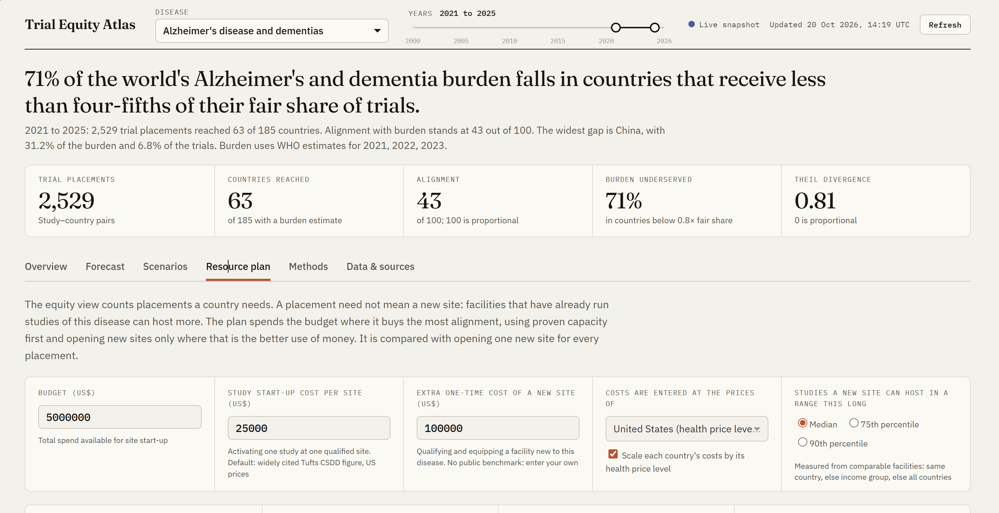

# Global Clinical Trial Equity Intelligence



## Overview

Clinical research is most useful when the populations represented in trials reflect the populations affected by disease. In practice, research activity is often concentrated in a relatively small number of countries, while substantial disease burden remains under-represented.

This project examines that imbalance. It brings together registered clinical trial activity from ClinicalTrials.gov and disease burden estimates from the World Health Organization, then presents the results through an interactive analytical dashboard. The aim is to support better questions about geographic representation, not to produce a league table of countries or an automated site-selection decision.

The dashboard is intended for trial planners, epidemiologists, public health researchers, research funders and policy teams who need a clear view of where research activity appears disproportionate to health need.

## Questions the dashboard can help answer

The application is designed around practical research planning questions:

- Which countries carry a material share of the selected disease burden but host little or no registered trial activity?
- How closely does the geographic distribution of trial activity follow the distribution of measured burden?
- Which countries have the largest estimated shortfall relative to proportional representation?
- Has global trial activity for the selected disease been increasing or declining?
- How might an additional portfolio of trial sites change the overall distribution?
- How sensitive are scenario results to uncertainty in burden and site placement?
- For a given budget, how much alignment can be bought, and how much of it can come from sites that already run trials rather than new ones?

The dashboard provides an executive overview, a country-level analytical table, a short-term forecast, a scenario planning workspace and a resource planner. All calculations are performed from versioned Parquet snapshots so that results can be reproduced outside the user interface.

## Data sources

### Clinical trial activity

Trial records are retrieved from the [ClinicalTrials.gov API version 2](https://clinicaltrials.gov/data-api/api). The source is normally refreshed on weekdays. The application records both the upstream data timestamp and the time at which the local analytical snapshot was published.

The historical extraction uses a unique NCT study and country combination as its activity unit. A study listed in three countries contributes one activity unit to each country. Multiple facilities belonging to the same study within one country are counted once. For that reason, the measure should be interpreted as registered study-country activity, not as a literal count of individual research facilities.

Conditions are assigned to diseases using a curated list of terms for each disease. Three rules keep the matching precise:

- A term must start at a word boundary.
- A term whose last word is three characters or fewer must also end at one.
- Each disease can list phrases removed before matching, such as *respiratory depression* for depression or *pulmonary hypertension* for hypertensive heart disease.

A study can count towards more than one disease when its registered conditions genuinely match more than one. The matching rules are tested against real condition labels in `tests/test_matching.py`.

### Diseases covered

Thirty-three diseases are covered, in nine groups. They were chosen to include the leading causes of disease burden, conditions where research is concentrated in high-income countries, and conditions WHO identifies as needing attention.

| Group | Diseases |
| --- | --- |
| Infectious and parasitic | HIV/AIDS, tuberculosis, malaria, lower respiratory infections, diarrhoeal diseases, viral hepatitis, meningitis, measles, neglected tropical diseases |
| Maternal and neonatal | Maternal conditions, neonatal conditions |
| Cancers | Lung, breast, cervical, colorectal, liver, stomach and prostate cancer |
| Cardiovascular and metabolic | Ischaemic heart disease, stroke, hypertensive heart disease, diabetes, chronic kidney disease |
| Respiratory | COPD, asthma |
| Mental and neurological | Depressive disorders, anxiety disorders, Alzheimer's disease and dementias |
| Digestive | Cirrhosis of the liver |
| Injuries | Road traffic injuries, self-harm |
| Inherited and congenital | Sickle cell disease, congenital anomalies |

Two diseases combine several WHO causes:

- **Viral hepatitis** sums acute hepatitis with liver cancer and cirrhosis caused by hepatitis B and C, where most of its burden falls.
- **Neglected tropical diseases** sums the WHO neglected tropical diseases that are estimated separately, including dengue, leishmaniasis, schistosomiasis, Chagas disease, rabies, trachoma, leprosy and intestinal worms.

Trials for hypertensive heart disease are matched on hypertension generally, because that is how blood-pressure research is registered.

The extraction also keeps facility-level detail (facility name, city, coordinates) in `data/clean/ctgov_facilities.parquet`. About a third of listings are anonymised by sponsors ("Research Site", "GSK Investigational Site", a call-centre notice). They are detected by name pattern, or because one name is listed in several cities within the same study, and are excluded from facility-level capacity measures.

### Disease burden

Burden data are the [WHO Global Health Estimates 2023](https://www.who.int/data/gho/data/themes/mortality-and-global-health-estimates/global-health-estimates-leading-causes-of-dalys) country tables: absolute DALYs by cause for both sexes and all ages, for the estimate years 2000, 2010, 2015 and 2019 to 2023. Each disease maps to exactly one WHO GHE cause code (for example tuberculosis is code 30 and HIV/AIDS code 100). The GHO OData API is not used because it publishes cause-specific DALYs only for regions.

You choose any range of years in the dashboard (for example 2019 to 2024, or a single year). Trial activity is the sum of study starts across those years. Burden is the mean of the WHO estimate years inside the range; a range with none (such as 2024 to 2026) uses the latest earlier estimate year. The line under the year selector shows which estimate years were used. When the range ends in the current year, that year counts only studies registered so far. The default view is the five most recent complete years.

The pipeline still publishes `data/gold/country_interval_disease.parquet` for fixed five-year blocks, for export and the R implementation. It uses the same burden rule.

Shares are calculated from absolute DALYs, so a country's share reflects how many people are affected, not only how intensely. The DALY rate per 100,000 is kept alongside for reference.

Burden estimates are published less frequently than trial registrations. They are therefore treated as a reference distribution rather than a live epidemiological signal.

> **Correction (October 2026).** Earlier snapshots matched WHO indicators by keyword and took any code beginning `SA_` to be a DALY series. In the WHO catalogue `SA_` denotes substance-abuse indicators, so several diseases were measured with unrelated series (tuberculosis used drowning DALYs and HIV/AIDS used alcohol-policy indicators). Results produced before this correction should not be used.

## Core measures

### Equity Ratio

For country `c`, the Equity Ratio is:

```text
Equity Ratio(c) = trial activity share(c) / burden indicator share(c)
```

An Equity Ratio of 1 indicates proportional alignment within the selected analytical cohort. A value below 1 indicates less registered activity than expected from the burden reference. A value above 1 indicates greater registered activity than expected.

The ratio is descriptive. It does not measure trial quality, recruitment performance, regulatory readiness, health-system capacity or the appropriateness of a particular site.

### Alignment score

The alignment score converts the total variation distance between the trial activity distribution and the burden distribution to a scale from 0 to 100:

```text
Alignment score = 100 x (1 - total variation distance)
```

A score of 100 represents proportional alignment. Lower values indicate greater geographic divergence. The score is useful for communication, while the underlying country-level shares should be retained for substantive interpretation.

### Theil divergence

The Theil measure summarises the divergence between trial activity share and burden share. A value of zero indicates proportional alignment. Larger values indicate greater concentration away from the burden reference. Unlike the headline alignment score, the Theil measure is not bounded at 100.

### Sites required for individual parity

The country diagnostic solves the following equation:

```text
(current activity + additional sites) / (global activity + additional sites) = burden share
```

This accounts for the fact that adding activity changes both the country numerator and the global denominator. The results for individual countries must not be added together and treated as a global plan.

## Forecasting approach

The forecast models annual global study-country activity for the selected disease. It fits a log-linear trend to the most recent complete years and uses residual bootstrap sampling to produce an 80 per cent uncertainty interval.

The model is deliberately transparent. It is suitable for directional portfolio discussion, but it does not account for protocol pipelines, regulatory approvals, sponsor strategy, competitive trials, recruitment capacity or unexpected changes in registration practice. It should not be described as a forecast of enrolment or study success.

## Scenario planning

The scenario laboratory allocates a user-defined number of additional sites using one of three rules:

- **Equity gap:** prioritises countries with the largest shortfall against their burden-aligned target.
- **Disease burden:** allocates in proportion to the burden reference.
- **Hybrid:** combines equity gap and disease burden, with greater weight placed on the equity gap.

Allocations are whole numbers. The dashboard recalculates country shares, Equity Ratios, the alignment score and Theil divergence after allocation. Monte Carlo simulation introduces variation in both burden and site placement, producing a range rather than a single deterministic claim.

These scenarios are planning aids. A real site strategy would also need evidence on eligible population, standard of care, competing trials, investigator capability, laboratory and pharmacy infrastructure, regulatory timelines, contracting, cost, travel burden and community acceptability.

## Resource planner

The equity measures say how many additional study placements a country needs. A placement does not have to mean a new site. A facility that has already run studies of the disease can host more, and a new site, once established, can host several studies. The resource planner turns a budget into a plan that uses proven capacity first and opens new sites only where that buys more alignment per dollar.

### What is measured

| Input | Source | Definition |
| --- | --- | --- |
| Existing spare capacity | ClinicalTrials.gov facility listings | For each named facility, the most studies of the disease it started in any window as long as the selected range (ending no later than the range), minus the studies it already has in the selected range. Only facilities active in the selected range or the equal-length window before it count. |
| New-site capacity | ClinicalTrials.gov facility listings | The median, 75th or 90th percentile (an observed value) of demonstrated capacity among facilities in the same country. Where fewer than five named facilities exist, the World Bank income group is used, then all countries. |
| Country cost level | World Bank ICP 2021, "Actual health" price level index (World = 100) | Costs are scaled by the country's index relative to the reference country. The ICP GDP price level is a labelled fallback. Countries with neither are not allocated and are listed. |
| Infrastructure context | World Development Indicators | Physicians and hospital beds per 1,000, electricity access, health spending per capita, the logistics performance index and researchers per million, shown for each country in the plan. |
| Candidate cities | ClinicalTrials.gov facility listings | For countries that need a new site, the cities with the most named facilities active in any tracked disease recently. A country with none is marked as having no recorded research facility. |

### What the planner enters

- **Budget**, in US dollars at the reference country's prices.
- **Study start-up cost per site.** The default of US$25,000 is the widely cited Tufts CSDD figure for activating one site for one study. It is dated and reflects US prices.
- **Extra one-time cost of a new site.** This covers qualifying and equipping a facility new to the disease. No robust public benchmark exists, so the default of US$100,000 is a placeholder to be replaced. The panel "If a new site costs more or less" shows how the plan changes at 0.5, 2 and 4 times this value.

### How the plan is chosen

At each step the planner compares, across eligible countries, two actions:

1. Add one study at a facility with spare capacity, at the study start-up cost.
2. Establish a new site, at the new-site cost plus study start-up costs, and fill it up to its measured capacity or the country's parity need.

It takes the action with the largest gain in alignment score per dollar, and stops when the budget runs out or no action improves alignment. When the portfolio is so small that any single placement overshoots a country's burden share, the planner looks ahead. It tries rounds of 2, 4, 8 and more placements, shared out by each country's gap to its burden-proportional target. The baseline for comparison opens one new site for every placement.

The dashboard reports the alignment reached, the existing facilities and new sites involved, the spend, and the saving for the same equity gain compared with the baseline. It also shows a spend-to-alignment curve to three times the budget, a map of the facilities and cities in the plan, and an exportable country table.

### Limits

- Facility names are free text. Name variants of one hospital are counted as separate facilities, and anonymised listings are excluded. Both understate existing capacity, so the plan errs towards opening new sites.
- Capacity is the number of studies a facility started within a window as long as the selected range, not participants enrolled. Very short ranges (one or two years) give small, noisy capacity figures.
- The planner does not model recruitment rates, regulatory timelines, competing trials or sponsor strategy, and cost scaling uses a whole-sector health price level, not quotes for a specific protocol.

## Live data behaviour

The application uses near-real-time refresh rather than continuous streaming. A user can refresh the selected disease directly from ClinicalTrials.gov. Once extraction and validation complete, the clean and gold data layers are published atomically. A running dashboard will therefore see either the previous complete snapshot or the new complete snapshot, never a partly written file.

The interface checks for a newer local snapshot every five minutes. A freshness badge distinguishes a recently published live snapshot from the repository snapshot supplied with the project.

To refresh one disease from the command line:

```powershell
py -m py.live --cause DIAB
```

To inspect the current refresh status:

```powershell
py -m py.live --status
```

## Installation and local use

Python 3.11 or later is recommended.

```powershell
py -m pip install -r requirements.txt
py app.py
```

Open `http://127.0.0.1:8050` in a browser.

For a local production-style process, use Waitress:

```powershell
py -m waitress --listen=0.0.0.0:8050 app:server
```

## Rebuilding the analytical data

The complete pipeline can be run with:

```powershell
py -m py.build
```

The build performs four stages:

1. Retrieve WHO Global Health Estimates burden data.
2. Retrieve and classify ClinicalTrials.gov records, including facility detail.
3. Retrieve World Bank price levels and infrastructure indicators.
4. Construct the country, period and disease equity measures used by the dashboard.

A full ClinicalTrials.gov rebuild can take some time because records returned by several disease synonyms must be retrieved and deduplicated.

## Project structure

| Component | Purpose |
| --- | --- |
| `app.py` | Dash application and user-facing analytical views |
| `assets/style.css` | Responsive visual design |
| `config/sources.yaml` | Source, refresh and modelling settings |
| `py/ctgov.py` | ClinicalTrials.gov extraction and condition classification |
| `py/global_health_sources.py` | WHO Global Health Estimates burden extraction |
| `py/resources.py` | World Bank price levels, infrastructure indicators and country metadata |
| `py/planner.py` | Facility capacity, cost scaling and budget-constrained site planning |
| `py/methods.py` | Statistical methods reference shown in the dashboard's Methods tab |
| `py/indices.py` | Country-level equity calculations |
| `py/analytics.py` | Forecasting and allocation simulation |
| `py/live.py` | Atomic selected-disease refresh and provenance metadata |
| `tests/` | Analytical unit tests |
| `data/clean/` | Harmonised source snapshots |
| `data/gold/` | Dashboard-ready analytical snapshots |
| `r/shiny_app.R` | Earlier Shiny implementation retained for reference |

Underscores appear only in literal code identifiers and filenames, where changing them would break imports or data contracts. User-facing headings and metric names use normal written English.

## Quality checks

Run the automated checks before publishing a new version:

```powershell
py -m pytest -q
py -m ruff check app.py py tests
py -m compileall -q app.py py
```

The tests cover the parity calculation, integer allocation, alignment score, forecast intervals, current-year interval handling, disease acronym matching and exclusion of WHO regional aggregates. Planner tests cover facility capacity (excluding anonymised listings and later activity), the fallback for new-site capacity, cost scaling without imputation, reuse of capacity against the baseline, exclusion of uncosted countries, the lookahead for small portfolios, and how placements are assigned to facilities.

## Appropriate use

This application is a research planning and policy analysis tool. It should be used to identify questions, test allocation assumptions and expose geographic imbalances that warrant further investigation. It is not a clinical decision tool, a causal model, a substitute for country feasibility assessment or a basis for automated funding decisions.
